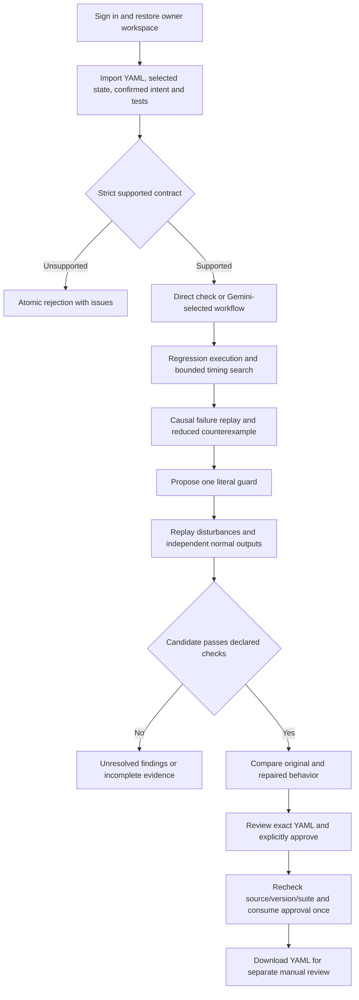

# Rehearse Automations — implementation and handoff report

Updated October 16, 2026. Branch: `new/automation`.

## 1. Delivery status

The v1 application, its supported execution model, conversational MCP workflow, persistence, replay, verified guard repair and explicit YAML export are implemented. Phases 1–5 and the engineering/evaluation/release-preparation work in Phase 6 have been committed in steps to this branch. Phase 6's human trials, video, licensing/access decision and final competition submission still require the owner. A hosted service and native Alexa account connection have not been published.

The complete working reference is [the overview](../overview.md). [Deployment instructions](../deployment.md) cover local judging and optional HTTPS. [The submission pack](../submission.md) supplies a demo sequence, draft description, developer feedback and the remaining checklist.

## 2. What we built and why

Rehearse is a conversational debugger and preflight checker for a declared subset of Home Assistant automations. Its customer already has rules and needs to check whether a change will break an intention. The user supplies selected entity state, YAML, confirmed desired behavior and scenarios with independently specified expected outputs.

The assistant starts an investigation, but executable analysis supplies the result. Rehearse can show a reproducible failure, the action chain causing it, a small proposed repair, a replay of the same inputs after repair, and regression evidence that ordinary behavior survives. The user reviews the exact YAML and explicitly approves its export. The application never installs a patch into a home.

The reference example is a motion-triggered delayed lamp-off rule and a separate manual-hold rule. Hold turns the lamp on at 250 virtual milliseconds; the old motion continuation turns it off at 600 ms. The confirmed intention says hold should keep it on. A guard immediately before off prevents that continuation while ordinary motion still switches off normally. Other supported imports use the same engine; entity names and the reference scenario are not hard-coded execution branches.

## 3. End-to-end flow



The browser is a real MCP client. After ordinary account login it sends `initialize`, `notifications/initialized`, `tools/list` and `tools/call` over `/mcp`, negotiating protocol 2025-11-25. Public examples/evidence/guide and account login use ordinary HTTP. The authenticated REST facade remains available to other callers and reaches the same domain service.

## 4. Implementation map

| Component | Implementation | Responsibility |
| --- | --- | --- |
| Contract | `src/automation/schema.js` | Strict Zod types, references, confirmed intent, entity/rule limits and canonical hashes |
| YAML boundary | `importYaml.js` | Bounded HA YAML 1.1 parsing, atomic unsupported rejection, source lines and normalized export |
| Execution | `engine.js`, `eventQueue.js` | Pure virtual clock, stable queue, single/restart cancellation, sequential actions, findings and parent-linked traces |
| Verification | `verification.js` | Potential dependencies, explicit regression assertions, bounded timing search, event-deletion reduction, guard candidates and rechecks |
| Workflow | `service.js` | Owner projects, versions, saved runs, conversation and review/export lifecycle |
| Conversation | `providers/gemini.js` plus validated service decisions | Real Gemini request selects permitted operations; deterministic results supply findings |
| Identity/storage | `identity.js`, `store.js`, Prisma migration | Salted scrypt passwords, one-hour scoped tokens, durable Neon documents and revision compare-and-swap |
| MCP/API | `tools.js`, `routes.js`, `server.js` | Twelve authenticated tools, public fixed evidence, login controls and Streamable HTTP transport |
| Browser | `public/automation/` | Consistent themed workspace, imports/editor, saved projects, conversation, replay, candidate comparison and explicit export |
| Browser transport | `public/automation/mcp.js` | MCP handshake/discovery, JSON response validation, expired transport recovery and no automatic retry of ambiguous writes |
| HA read adapter | `haClient.js` | Operator-configured selected-state GET reads, streaming byte cap, timeout and token isolation |
| Independent runtime | `automation/testbed/run_ha.py` | Disposable pinned HA Core instance, virtual helpers, authenticated REST/WebSocket observations and actual-file export checks |

Paths in the component table are relative to `apps/mcp-server/` unless explicitly prefixed otherwise. The engine has no database, LLM or network dependency. Changing the language provider cannot change engine findings. The model cannot approve/export/install a patch or silently modify confirmed intent.

The twelve tool names are `automation.import`, `list`, `get`, `inspect`, `preflight`, `search`, `repair`, `trace`, `compare`, `review`, `export` and `respond` (all with the `automation.` prefix). Their full behavior and limits are in the overview.

## 5. State, approval and integration boundaries

Two additive tables, AutomationAccount and AutomationWorkspace, retain returning identity, source versions, current analysis, traces and bounded conversation history. Existing planner tables remain separate. Memory mode is available for zero-provider local evaluation and clearly loses data on restart; configured Neon failures do not silently switch to memory.

Review binds owner, source/version/hash, suite and exact candidate/export payload. Export recomputes verification and consumes a ten-minute approval through revision compare-and-swap. Stale source, expired/reused approval and concurrent duplicate export are rejected. A lost HTTP response may mean a write committed; restore before retrying. Only an explicitly rejected invalid MCP session is automatically reinitialized/retried.

Gemini and Neon are live integrations previously exercised with the private configuration. Weather and TomTom remain part of the original planner at `/dayboard`; they are unnecessary for automation verification. The HA reference runtime is real software running virtual helpers, not physical-device evidence. The optional household read adapter is implemented but not configured to a real home. Production HA writes, automatic rollback and native Alexa account linking are outside this v1 delivery.

## 6. Phase delivery and push history

| Step | Delivered | Commit |
| --- | --- | --- |
| Phase 1 | Strict import contract, source mapping, selected-state connector and isolated HA feasibility | `2ffb647` |
| Phase 2 | Deterministic event simulator, causal replay and independent semantic comparison | `480946c` |
| Phase 3 | Bounded search, verified scoped repair and normal-output preservation | `20efe5b` |
| Phase 4 | Gemini/MCP workflow, returning identity, Neon and immutable approval/export binding | `dad8812` |
| Phase 5 | Integrated workshop, browser verification and actual exported YAML execution in HA | `f7f0c77` |
| Phase 6A | Workshop directly uses MCP handshake, discovery and domain tool calls | `e880100` |
| Phase 6B | Frozen synthetic acceptance corpus and recorded live LLM-only comparison | `aedf8de` |
| Phase 6C | Browser-native fetch correction, HTTPS-origin tests, config checker and offline release gate | `3bf371d` |
| Phase 6D | This final report, revised overview and submission materials | See final documentation commit in branch history |

Detailed reports and machine-readable captures are in this directory. No PR or main-branch merge is part of this delivery.

## 7. Verification actually performed

A clean Git source archive of commit `3bf371d` was expanded outside the workspace. It contained no ignored environment file or existing node_modules. Root and server `npm ci`, Prisma client generation and `npm run check:release` completed successfully. The release gate checked:

- Complete test suite: **132 tests, 130 passed, 0 failed, 2 opt-in database tests skipped**.
- Syntax for 107 JavaScript files and successful Prisma schema validation.
- Frozen acceptance set: 13/13 declared status, state and repair outcomes.
- Six semantic cases matched the previously captured independent HA observations.

Earlier separately enabled Neon verification tested returning identity, state restoration and concurrent approvals with isolated records, then cleaned those records. The final offline run deliberately does not repeat live database tests. Phase 5 tested the actual downloaded YAML bytes against a file parsed and executed by HA Core 2024.12.5. Checked-in captures describe that historical runtime; this is not a blanket claim about later releases or hardware.

Actual final-browser checks used a disposable local memory runtime: account creation, guided import, direct preflight, the 600 ms failure, same-input repaired replay and causal chain. Integration tests additionally exercised approved export/reuse rejection, transport expiry and authentication expiry. Earlier Phase 5 browser checks covered Neon restoration, live conversation, source edits, connectivity failure and responsive layouts. Microphone quality remains a manual permission/browser check.

The Phase 6 corpus has three conflicts, four clean cases, three incomplete cases, one missing-intent case and two unsupported modes. It produced zero false alarms among its four clean cases and zero missed violations among its three conflicts. The single eligible repair preserved its independently specified ordinary output. A renamed/shifted case checks generalization beyond reference identifiers and timestamps.

The live Gemini-only comparison matched 6/10 labels; Rehearse matched 10/10 on the same ten. Raw answers and timings are in [phase-6-evaluation.json](phase-6-evaluation.json). This small author-written synthetic set is not a blinded benchmark, representative user study, repair-quality comparison or winning guarantee. No participant results have been fabricated.

## 8. Run it step by step

Use Node 22.9+ and start from the repository root:

```powershell
npm ci
npm ci --prefix apps/mcp-server
npm run prisma:generate
npm run check:release
npm --prefix apps/mcp-server start
```

Without `.env`, direct checks run in temporary memory. Open `http://localhost:3000/automations`, create an account with a 12–128 character password, load the guided example, read the intent/output JSON, confirm and import. Press Run preflight, follow the causal chain, inspect Repair review, compare before/after, review the exact patch and explicitly approve/download. The original planner is at `/dayboard`.

For persistence/conversation configure the ignored `apps/mcp-server/.env` from root `.env.example`. Set `REPOSITORY_MODE=prisma`, the existing private `DATABASE_URL`, `GEMINI_API_KEY`, `GEMINI_MODEL`, and a stable private `JWT_SECRET`. Run `npm run check:automation-config`, `npm run prisma:migrate`, `npm run prisma:status`, then start. The committed migrations are additive; never substitute reset/drop commands. No OAuth client is needed for local workshop login or the web simulation.

For a new import supply supported YAML and JSON containing exactly entities, confirmed expectations and suite. Include an independent expected final output per regression and an ordinary-behavior case. Consult `automation/fixtures/override-debug.json` and the overview for the exact schema. Unsupported input rejects atomically rather than producing a partial pass.

Useful commands:

```powershell
npm run test:automation
npm run automation:evaluate
npm run check:automation-config
node apps/mcp-server/scripts/automationCli.js repair automation/fixtures/override-debug.yaml automation/fixtures/override-debug.json
# Optional live provider request:
node apps/mcp-server/scripts/automationLlmSmoke.js
# Optional ten-request evaluation; output stays ignored:
node apps/mcp-server/scripts/evaluateAutomation.js --llm --output artifacts/automation/evaluation-rerun.json
```

The output directory must exist for the optional file output. Live commands consume provider requests. HA reproduction requires the separate pinned testbed described in its README. Deployment configuration checks do not validate a key or establish a live service.

## 9. Known limitations and open release risks

The supported subset covers explicit state/event triggers, literal state conditions, on/off/light brightness, sequential actions, constant delays and single/restart. It rejects templates, clock/DST triggers, dynamic targets, queued/parallel and arbitrary services. Search varies finite event timings and two tie orders; repair inserts one literal guard. Unknown state, unexercised intent, pending work and exhausted budgets remain unresolved. No complete smart-home twin, exhaustive safety proof or general repair synthesis is claimed.

`npm audit` at both package roots reports **four high-severity entries** through Prisma 6.19.1's config dependencies (`effect` and `deepmerge-ts`, with inherited Prisma/config entries). npm proposes a major Prisma 7 upgrade. This remains unresolved; no forced major upgrade or untested transitive override was applied. Before public production deployment, review the advisories and perform a separately tested dependency migration/remediation. The passing release gate is not a clean security-audit claim.

The local account system lacks production account recovery/OIDC/revocation. Generic OAuth authorization is demo-only and does not provide finished native Alexa linking. MCP sessions/rate buckets are in process memory, so deployment instructions target a single process. Reviewer credential provisioning, secret rotation and hosting configuration belong in the private deployment environment.

## 10. Exact remaining owner actions

| Item | Required now? | Action |
| --- | --- | --- |
| License/repository access | Yes | Licensing is pending by your explicit choice. Choose a public open-source license or arrange private judge access before submitting. No license was added. |
| Demo video | Yes | Record the actual working flow using the storyboard; publish your video and enter its URL. |
| Devpost submission | Yes | Review the draft, enter team/track/repository/testing information and developer feedback, then submit before the official deadline. |
| Reviewer setup | Yes | Make this branch discoverable; provide exact branch/run steps and private test credentials if using a private hosted account. |
| Independent user trials | Recommended, not completed | Ask consenting testers to use the worksheet. Record actual completion/friction; do not invent outcomes. |
| Realistic household imports | Recommended | Supply your own supported cases and confirm their desired/ordinary outputs. |
| HTTPS hosting | Optional for local judging | Choose a host/domain and follow deployment.md if you want a public demo. No deployment is claimed. |
| Dependency advisories | Before production deployment | Review/remediate Prisma-chain advisories with migration/regression verification. |
| Stable secrets and key rotation | Before deployment | Configure a private stable JWT secret and rotate previously shared provider keys. |
| Native Alexa connection | Future gated work | Current FAQ says the toolkit is unavailable to ordinary entrants; use the permitted web simulation. |
| Broader HA semantics/physical tests | Future product scope | Expand only with independent runtime conformance. |
| Original traffic monitor | Deferred by your request | Still needs an always-on worker and private notification destination if that planner feature is revisited. |

The [official rules](https://amazonappdev2026.devpost.com/rules) checked October 16 list the deadline as October 23, 2026 at noon PDT, which is October 24 at 12:30 a.m. IST. Recheck the page before final submission. The [FAQ](https://amazonappdev2026.devpost.com/details/faqs) permits local judging and the simulated Alexa+ route. Use that description consistently; neither a localhost MCP test nor HTTPS hosting proves native Alexa connectivity.
